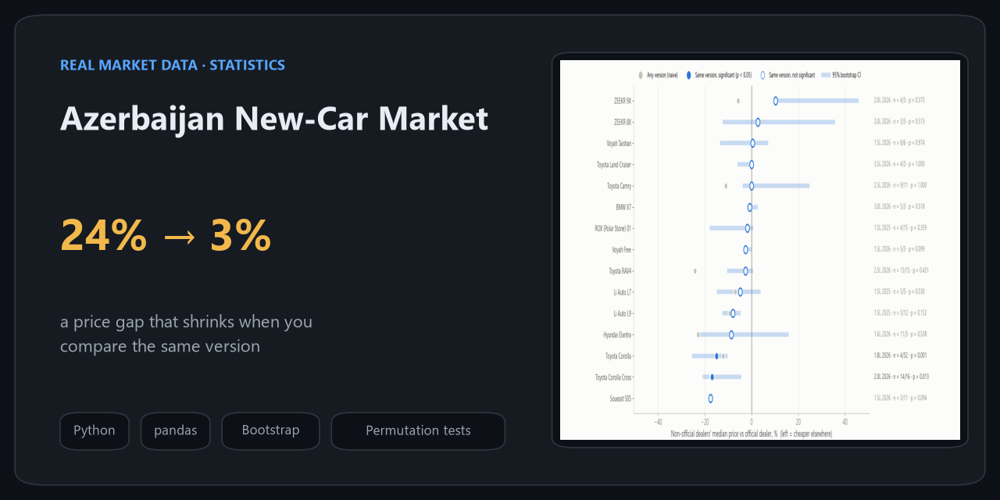
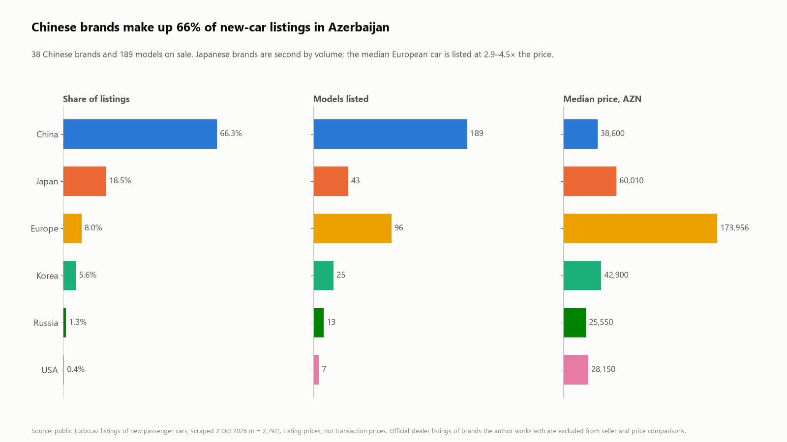
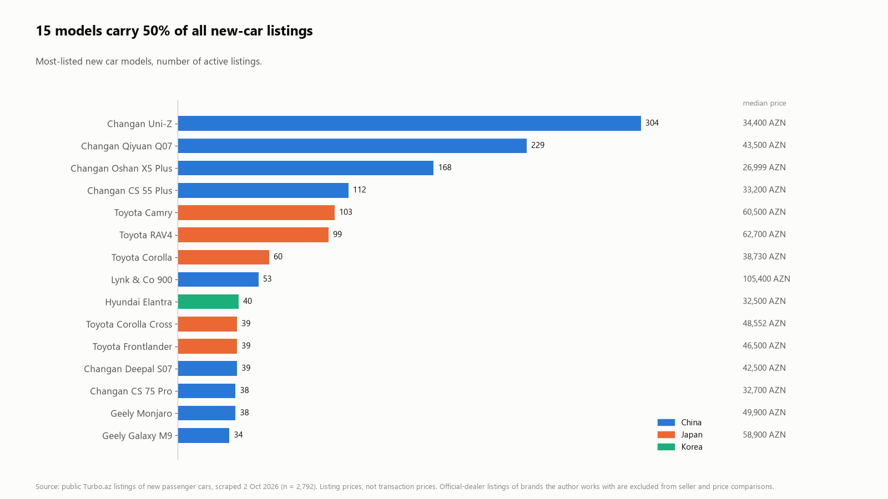
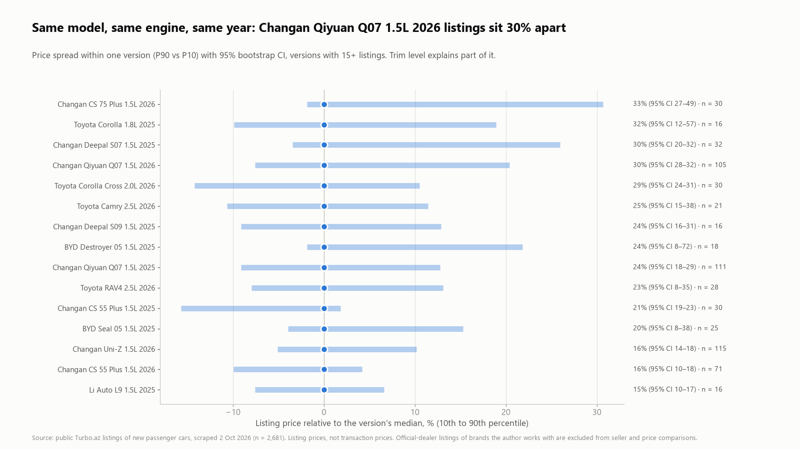
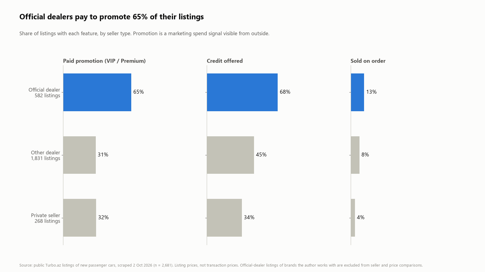
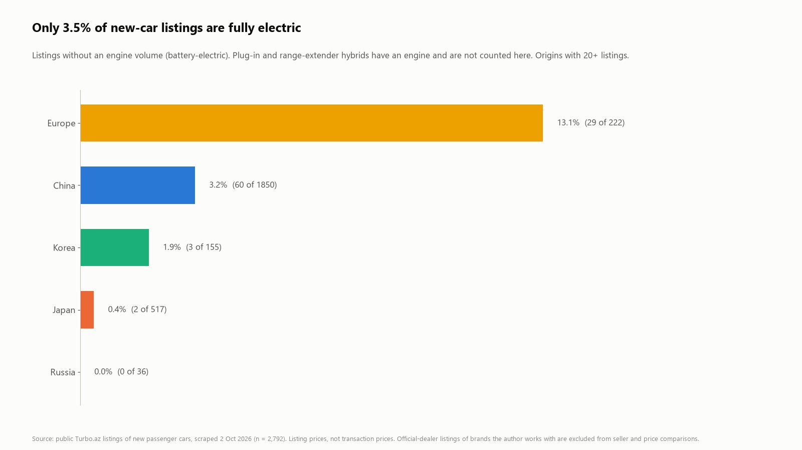

# Azerbaijan New-Car Market: Turbo.az Listings Analysis

What 2,792 active new-car listings on Turbo.az say about Azerbaijan's car market: who sells, at what price, how official dealers compare with other dealers, and how sellers market their cars. Every headline number comes with a confidence interval or a test.

**Real, public data** (listings scraped on 2 October 2026), analysed the way I would for a marketing and sales team.

**Stack:** Python (pandas, NumPy) · matplotlib · bootstrap and permutation tests written from scratch

---

## Key findings

### 1. Chinese brands are two thirds of the market


66% of new passenger-car listings are Chinese brands (95% CI 64–68%), from 38 brands and 189 models. Japanese brands are second with 18.5%. The median European car is listed at 2.9–4.5× the price of a Japanese or Chinese one.

### 2. A handful of models carry the market


15 models account for half of all listings (50%; 51% after removing duplicate listings).

### 3. "Cheaper at other dealers" depends on what you compare


Compared at model level, non-official dealers list the Toyota RAV4 24% below the official dealer. Compared like-for-like (same engine, same model year), the gap is 2.6%, and it is not statistically significant (95% CI −10.4% to +0.6%, permutation p = 0.43). Most of the difference was a different car: typically a version with a smaller engine.

Of 15 models with enough listings, only 2 gaps hold up: Toyota Corolla 1.8L (−15%, p = 0.001) and Toyota Corolla Cross 2.0L (−17%, p = 0.013). After a Holm correction for testing 15 models at once, only the Corolla remains significant (adjusted p = 0.011).

**Why it matters:** the model-level comparison is the one usually quoted. Checking what sits in each average before comparing them changes the conclusion for most models here.

### 4. Same version, very different prices


Even with the same model, engine and year, the 10th and 90th percentile listings can be 30% apart (Changan Qiyuan Q07 1.5L 2026: 95% CI 28–32%, n = 105). Trim levels explain part of this. For a buyer, this is where shopping around pays. For a seller, it shows which versions have no clear market price.

### 5. Official dealers market harder


Official dealers pay to promote (VIP / Premium) 65% of their listings, against 31% for other dealers: a difference of 34 percentage points (95% CI 30–39, p < 0.001). They also offer credit more often (68% vs 45%; +23 pp, 95% CI 18–27). Both differences hold after removing duplicate listings (+35 pp and +19 pp).

Does promotion go with lower prices? For other dealers, no: promoted and non-promoted listings sit at the same median price for their version. Official dealers' promoted listings are closer to the version median (+5%) than their non-promoted ones (+10%), but the non-promoted group is small (48 listings) ([`outputs/05b_promotion_vs_price.csv`](outputs/05b_promotion_vs_price.csv)). This is a correlation, not a test of what promotion causes.

### 6. Electric cars are still a niche


Only 3.5% of new-car listings are battery-electric (95% CI 2.9–4.2%). Most Chinese "new energy" models on sale are plug-in or range-extender hybrids, which have an engine and are not counted here.

---

## Statistical checks

All results are in [`outputs/07_statistical_checks.csv`](outputs/07_statistical_checks.csv) and the per-model files in [`outputs/`](outputs/).

| Check | Method | Result |
|---|---|---|
| Shares (Chinese brands, electric) | Wilson 95% interval | Intervals are narrow (±2 pp or less); conclusions do not depend on sampling noise. |
| Official vs other dealers' price gap | Bootstrap 95% CI of the median gap (4,000 resamples) + two-sided permutation test (4,000 shuffles) | A gap counts as significant only if the CI excludes 0 **and** p < 0.05. With 3 listings in a group, bootstrap intervals of a median are too narrow, so the permutation test is the gatekeeper. |
| Many models tested at once | Holm correction | 2 of 15 gaps significant at p < 0.05; 1 after correction. |
| Promotion and credit differences | Two-proportion z-test, 95% CI | p < 0.001 for both, with and without duplicates. |
| Duplicate listings | Same seller, same version, same price counted once | 507 of 2,792 listings (18%) are duplicates. Every headline result moves by 4 percentage points or less; none changes direction. |
| Price dispersion | Bootstrap 95% CI of the P90/P10 spread | The chart headline uses the version whose spread is highest at the lower end of its CI, not the highest point estimate, which had a CI of 12–57%. |

## Method

| Step | Rule |
|---|---|
| Scope | New passenger cars only: model year 2024+, under 1,000 km. Motorcycles, ATVs, trucks, buses and classic cars excluded (lists in [`src/analyze.py`](src/analyze.py)). |
| Seller type | *Official dealer* (marked official on Turbo.az), *other dealer*, *private seller*. |
| Like-for-like | Same brand, model, engine volume and model year. |
| Minimum sample | 3+ listings per seller type for price gaps, 15+ listings per version for dispersion. |
| Imported cars | Listings with an estimated price ("≈", imported on order) excluded from price comparisons. |
| Electric | No engine volume listed. One listing (a Genesis GV70) may be missing data rather than electric. |
| Confidentiality | I work with several brands in this market. Their official-dealer listings are left out of all seller-type and price comparisons (charts 3–5); the brands stay in the market overview. |

**Limits:** these are asking prices, not transaction prices. A listing count is not a sales count: fast-selling cars leave the site and some dealers list more actively than others. Origin is the brand's home country, not where the car is built.

## Data and ethics

- The raw scraped listings are **not published** in this repository; only aggregated results are. Redistributing a site's data can conflict with its terms of use.
- No individual seller is named in any chart or output. Sellers are grouped into three types.
- To reproduce: put your own export of the listings at `data/listings.csv` (columns in [`src/extract.py`](src/extract.py)) and run the analysis.

## Run it

```bash
pip install -r requirements.txt
python src/extract.py "path/to/export.html"   # -> data/listings.csv
python src/analyze.py                          # -> outputs/*.csv, images/*.png (about a minute: bootstraps)
```

## What a marketing team could do with this

- Track the like-for-like price gap on its core versions every week, not the model-level average.
- Use competitors' promotion share as a proxy for their marketing pressure.
- Flag versions with wide price dispersion: there, a clear price message can stand out.
